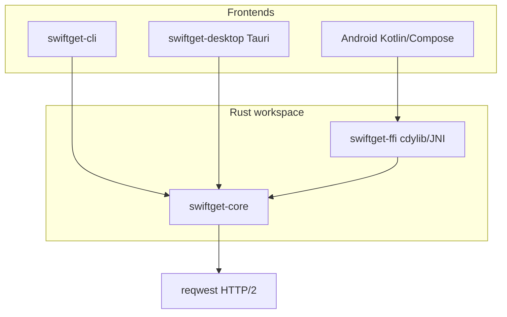

# SwiftGet

MIT-licensed, cross-platform download manager: multi-connection segmented HTTP(S)
downloads, per-host connection auto-tuning, multi-mirror racing, resumable JSON state,
token-bucket speed limits, checksum verification, a download queue/scheduler, and a
JDownloader-style **LinkGrabber**. Frontends include a **CLI**, a **Windows desktop**
app (Tauri v2), and an **Android** app (Kotlin + Compose + JNI into the Rust engine).

## Features

| Area | Status |
|------|--------|
| Up to 32 parallel connections, work-stealing segment split | Implemented |
| Per-host connection auto-tune (remember best count) | Implemented |
| Multi-mirror racing with demotion on errors | Implemented |
| Preallocated file, positional writes (no merge step) | Implemented |
| Resume via `.sgstate` JSON next to the file | Implemented |
| Link refresh callback (403/410) | Implemented |
| Retries with exponential backoff + jitter | Implemented |
| Per-download and global speed limiter | Implemented |
| MD5 / SHA-256 verification | Implemented |
| Queue, priorities, scheduled start, progress events | Implemented |
| Single-connection fallback when Range unsupported | Implemented |
| LinkGrabber (extract, probe, package, filter) | Implemented |
| HTTP/3 (QUIC) | Optional feature flag (`http3`), **off by default** |
| Windows NSIS installer bundle | **Planned** — use `--no-bundle` if NSIS download fails |
| Browser extensions / captcha solvers | **Not planned** in this repo |

### CLI (`swiftget`)

- `get` — download with connections, mirrors, checksum, speed limit
- `grab` — LinkGrabber (table or JSON)
- `resume` — continue from a state file
- `bench` — compare 1 vs N connections

### Desktop (Windows)

Dark/light theme, per-segment progress, live speed graph, add-download dialog,
LinkGrabber panel, settings, clipboard monitor, system tray, persisted queue.
See [apps/desktop](apps/desktop) and [docs/BUILD_WINDOWS_GNU.md](docs/BUILD_WINDOWS_GNU.md).

### Android

Material 3 UI, foreground download service, share targets, LinkGrabber, native
`libswiftget_ffi.so` via `cargo-ndk`. See [android/README.md](android/README.md).

## Architecture



```
SwiftGet/
├── crates/
│   ├── swiftget-core/     # engine + LinkGrabber
│   ├── swiftget-cli/      # swiftget.exe
│   └── swiftget-ffi/      # C ABI / JNI for Android
├── apps/desktop/          # Tauri v2 + TypeScript UI
├── android/               # Gradle + Compose app
├── vendor/windows-link/   # GNU Windows linking patch
└── docs/                  # Benchmarks, build notes
```

## Benchmarks

Measured on Windows 10, `x86_64-pc-windows-gnu`, release build. Full notes in
[docs/BENCHMARK.md](docs/BENCHMARK.md).

| Test | 1 conn | 16 conn | Speedup |
|------|--------|---------|---------|
| proof.ovh.net 100 MB | 16.45 MB/s | 18.97 MB/s | 1.15× |

On origins that throttle per connection, multi-connection gains are typically much
larger than on a single fast HTTP/2 stream.

## Build

### Prerequisites

- Rust 1.75+ (stable)
- On **Windows GNU** hosts: follow [.toolbin/README.md](.toolbin/README.md) and
  [docs/BUILD_WINDOWS_GNU.md](docs/BUILD_WINDOWS_GNU.md) for the `dlltool` workaround

### CLI and core (all platforms)

```powershell
cd E:\SwiftGet   # or your clone path
cargo build --release
cargo test
# binary: target/release/swiftget.exe
```

### Windows desktop (Tauri)

```powershell
cd apps\desktop
npm install
.\build-gnu.ps1              # or .\build-gnu.ps1 --no-bundle
# binary: target/release/swiftget-desktop.exe
```

Artifact paths: [docs/BUILD_OUTPUTS.md](docs/BUILD_OUTPUTS.md).

### Android (cargo-ndk + Gradle)

```powershell
$env:RUSTC_WRAPPER = ""   # recommended on the reference GNU Windows host

cd crates\swiftget-ffi
cargo ndk -t arm64-v8a -t armeabi-v7a -o ..\..\android\app\src\main\jniLibs build --release

cd ..\..\android
# local.properties -> sdk.dir=... (git-ignored)
.\gradlew.bat assembleRelease
```

Details: [android/README.md](android/README.md).

## Comparison (honest)

| Capability | SwiftGet | IDM | 1DM | ADM | Ghost DL 3 | JDownloader |
|------------|:--------:|:---:|:---:|:---:|:----------:|:-----------:|
| Open source (MIT) | Yes | No | No | No | Partial | Partial |
| Multi-connection segments | Yes | Yes | Yes | Yes | Yes | Yes |
| Work-stealing / dynamic split | Yes | — | — | — | — | — |
| Per-host auto-tune | Yes | Partial | Partial | Partial | — | — |
| Multi-mirror racing | Yes | Limited | Yes | Yes | — | Yes |
| Resumable state on disk | Yes | Yes | Yes | Yes | Yes | Yes |
| LinkGrabber / link extraction | Yes | No | Limited | No | No | **Best-in-class** |
| Captcha / host plugins | No | No | No | No | No | **Yes** |
| Windows GUI | Yes (Tauri) | Yes | — | — | Yes | Yes |
| Android app | Yes | No | Yes | Yes | — | Yes |
| HTTP/3 | Flag only | — | — | — | — | — |
| NSIS installer (this tree) | Scaffolded | Yes | — | — | — | — |

Em dash (—) means unknown or not a marketed feature; SwiftGet focuses on the engine and
three first-party frontends rather than a plugin ecosystem.

## License

MIT — see [LICENSE](LICENSE).

## Contributing

See [CONTRIBUTING.md](CONTRIBUTING.md).
