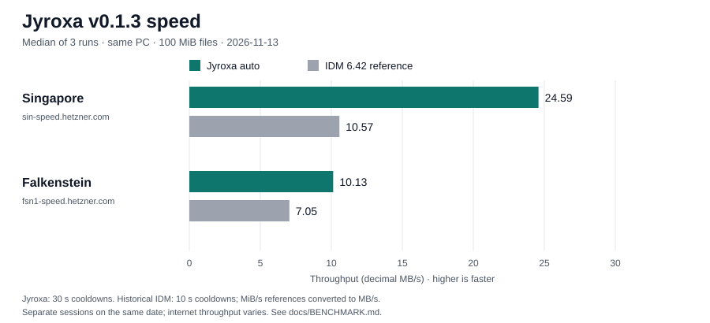

# Jyroxa


Jyroxa: a fast, open-source download manager for Windows and Android. Rust engine with adaptive multi-connection downloads, instant pause/resume, smart filename detection, a JDownloader-style LinkGrabber, tray and background downloads, and a modern UI.

## Speed

| Server | Jyroxa auto before, v0.1.2 (MB/s) | Jyroxa auto now, v0.1.3 (MB/s) | IDM 6.42 reference (MiB/s → MB/s) | Speedup vs IDM |
| --- | ---: | ---: | ---: | ---: |
| Singapore (sin-speed.hetzner.com) | 5.52 | **24.59** | 10.08 → 10.57 | **2.33×** |
| Falkenstein (fsn1-speed.hetzner.com) | 5.36 | **10.13** | 6.72 → 7.05 | **1.44×** |



Measured **2026-11-13**, same Windows PC, same Hetzner 100 MB files (100 MiB / 104,857,600 bytes), **median of three runs**. Jyroxa confirmation: 30-second cooldowns; historical v0.1.2 and IDM references: ten-second cooldowns. IDM was measured earlier that day and was not rerun for this release.

IDM’s supplied **10.08 / 6.72** references use MiB/s; decimal equivalents are shown above. Ratios and chart bars use matching decimal MB/s. These results describe two internet paths on this date. **Ghost Downloader could not be benchmarked headlessly yet**; no numbers are claimed.

[Method, ranges and source data](docs/BENCHMARK.md) · [Raw confirmation output](reports/release-0.1.3-bench.log).

## Features

### Engine (Rust)

- Adaptive multi-connection downloads with a throughput auto-tuner that tests wider counts and reverts unsuccessful trials
- HTTP/1.1 per-segment connections with work-stealing when ranges are supported
- 429/503 handling with `Retry-After` backoff and stall detection
- Resume after restart via `.jxstate` sidecars (reads legacy `.sgstate`)
- Multi-mirror racing, MD5/SHA-256 verification, global and per-download speed limiting
- LinkGrabber: extract, probe, filter, and package links from pages or text

### Desktop (Windows)

- Sidebar categories and filters, search and sort, bulk actions, context menu
- Keyboard shortcuts, drag-and-drop, LinkGrabber panel
- System tray, start with Windows, prevent sleep while downloading, auto-resume on launch
- Single-instance mutex, native notifications, light/dark themes
- NSIS installer and portable zip (includes redistributable `WebView2Loader.dll` from the [WebView2 SDK](https://developer.microsoft.com/microsoft-edge/webview2/))

### Android

- Material 3 UI with dynamic color
- Foreground service notification with pause/cancel actions
- WorkManager resume after reboot, Wi‑Fi-only option in settings
- JNI bridge to `libjyroxa_ffi.so` built via `cargo-ndk`

## Screenshots

Screenshots: see [docs/screenshots](docs/screenshots) (placeholders until assets are added).

## Download

Pre-built binaries from **GitHub Releases**:

| Artifact | Description |
| -------- | ----------- |
| `Jyroxa_0.1.3_x64-setup.exe` | Windows NSIS installer |
| `Jyroxa-0.1.3-windows-x64-portable.zip` | Portable `Jyroxa.exe` + `WebView2Loader.dll` |
| `Jyroxa-0.1.3-android-universal.apk` | Signed Android universal APK (arm64-v8a, armeabi-v7a, x86_64) |
| `SHA256SUMS.txt` | SHA-256 checksums for the files above |

## Build from source

- **Windows desktop / CLI:** GNU toolchain workflow in [docs/BUILD_WINDOWS_GNU.md](docs/BUILD_WINDOWS_GNU.md) (`x86_64-pc-windows-gnu`, `.toolbin` import libs).
- **Android:** JDK 17, Android SDK/NDK, `cargo-ndk`, then `./gradlew :app:assembleRelease` (see [android/README.md](android/README.md)).

Quick sanity checks:

```bash
cargo build --release
cargo test
cd apps/desktop && npm run build && cd src-tauri && cargo check
```

## Project layout

```
Jyroxa/
├── crates/
│   ├── jyroxa-core/     # download engine + LinkGrabber
│   ├── jyroxa-cli/      # jyroxa CLI binary
│   └── jyroxa-ffi/      # C ABI + JNI (Android)
├── apps/desktop/        # Tauri 2 + TypeScript UI
├── android/             # Gradle + Compose app
├── vendor/windows-link/ # Windows GNU linking patch
└── docs/                # build notes, benchmarks
```

## CLI examples

```bash
# Download with auto-tuning (up to 16 connections)
jyroxa get https://example.com/file.zip -c 16 -o ./downloads/

# LinkGrabber (JSON output)
jyroxa grab https://example.com/page -json

# Benchmark single vs multi-connection throughput
jyroxa bench https://example.com/100mb.bin -c 16 --modes auto,1,16
```

## License

MIT — see [LICENSE](LICENSE).
