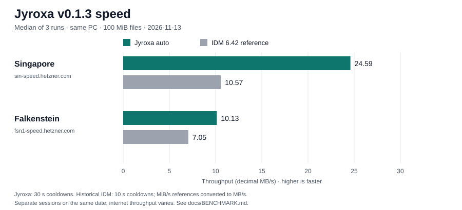

# Jyroxa v0.1.3 speed benchmark

Release confirmation measured on **2026-11-13**, on the same Windows PC as the archived IDM 6.42 reference measurements. Results describe these two internet paths on this date; routing, load and throttling can change them.

| Server | Jyroxa auto before, v0.1.2 (MB/s) | Jyroxa auto now, v0.1.3 (MB/s) | IDM 6.42 reference (MiB/s → MB/s) | Speedup vs IDM |
| --- | ---: | ---: | ---: | ---: |
| Singapore (sin-speed.hetzner.com) | 5.52 | **24.59** | 10.08 → 10.57 | **2.33×** |
| Falkenstein (fsn1-speed.hetzner.com) | 5.36 | **10.13** | 6.72 → 7.05 | **1.44×** |



Jyroxa throughput uses decimal MB/s (1 MB = 1,000,000 bytes). The requested IDM references, **10.08 Singapore / 6.72 Falkenstein**, were historically labeled MB/s, but their archived timings use MiB/s (1 MiB = 1,048,576 bytes). The table preserves those numbers and shows decimal equivalents. Speedups and chart bars use matching decimal units: `Jyroxa MB/s / (IDM reference × 1.048576)`. Ratios are approximate because the references were rounded to two decimals.

## Method

- Files: `https://sin-speed.hetzner.com/100MB.bin` (Singapore) and `https://fsn1-speed.hetzner.com/100MB.bin` (Falkenstein). These are named 100 MB files but contain **104,857,600 bytes (100 MiB)** each.
- Jyroxa: optimized Windows GNU release build (`opt-level = 3`, thin LTO, one codegen unit), engine revision `cddd95a` with release version metadata updated to 0.1.3.
- Headline values: **median of three completed auto-mode downloads**, maximum 16 connections. Each repetition creates fresh in-memory host statistics. CLI timing includes metadata/startup and completed file writes, rather than measuring only an instantaneous network peak. CLI connection output records the maximum observed count, despite its historical `ended` label.
- **30-second cooldowns** between repetitions and modes, plus 30 seconds between the two server commands. Singapore ran first. Headline auto measurements ran before release packaging builds.
- The exact requested `--modes auto` commands also schedule a fixed-16 control in this CLI version. These extra controls remain in the raw output and are excluded from the headline comparison. Falkenstein's added control overlapped subsequent packaging builds.
- Historical v0.1.2 auto baselines: **5.52 / 5.36 decimal MB/s**, same PC and files, median of three runs with ten-second cooldowns, measured 2026-11-13.
- IDM **6.42**: supplied reference medians **10.08 / 6.72 MiB/s**, same PC and files, median of three runs with ten-second cooldowns, measured 2026-11-13. These were collected earlier that day; IDM was **not rerun** for this release. This is a comparison against historical references, not a simultaneous or alternating-order controlled trial.
- Builds and release validation were headless. No visible app window, virtual desktop switching, or IDM launch was used for this release task.

```powershell
. C:\Users\lenovo\.jyroxa-tools\env.ps1
cargo test -p jyroxa-core
cargo build --release -p jyroxa-cli
target\release\jyroxa.exe bench https://sin-speed.hetzner.com/100MB.bin -c 16 --modes auto --repeat 3 --cooldown 30
# Wait 30 seconds after the first command finishes.
target\release\jyroxa.exe bench https://fsn1-speed.hetzner.com/100MB.bin -c 16 --modes auto --repeat 3 --cooldown 30
```

## Confirmation ranges and provenance

| Server | Auto minimum (MB/s) | Auto median (MB/s) | Auto maximum (MB/s) | Runs |
| --- | ---: | ---: | ---: | ---: |
| Singapore | 21.92 | 24.59 | 27.96 | 3 |
| Falkenstein | 8.70 | 10.13 | 10.89 | 3 |

- [Raw release confirmation output](../reports/release-0.1.3-bench.log), including commands, timestamps, CLI hash, and extra fixed-16 controls. PowerShell's mixed log encoding was normalized to UTF-8 without changing output values.
- [Historical reference provenance and unit conversion](../reports/benchmark-reference-2026-11-13.md), with [six archived IDM timing records](../reports/idm-reference-2026-11-13.csv).
- [Earlier auto-mode measurements](../reports/beat-idm-2026-11-13.md): **21.60 / 10.37 decimal MB/s**, three runs with 10–30 second cooldowns. Those values are retained as context; the table above uses the new release confirmation instead. Its original IDM percentage claims did not normalize units.
- [Release validation and artifact inventory](../reports/release-0.1.3.md).

Ghost Downloader **could not be benchmarked headlessly yet**. No Ghost throughput or speedup is claimed.

## What changed

Auto mode begins range downloads at eight connections, probes wider concurrency only when aggregate throughput improves, and reverts unsuccessful trials. Idle connections split active tails safely. Persistent buffered writes, fewer metadata requests, and avoiding unnecessary unlimited-transfer rate accounting reduce overhead. Public-server measurements remain variable; two servers and three samples per server do not establish a universal ranking.
